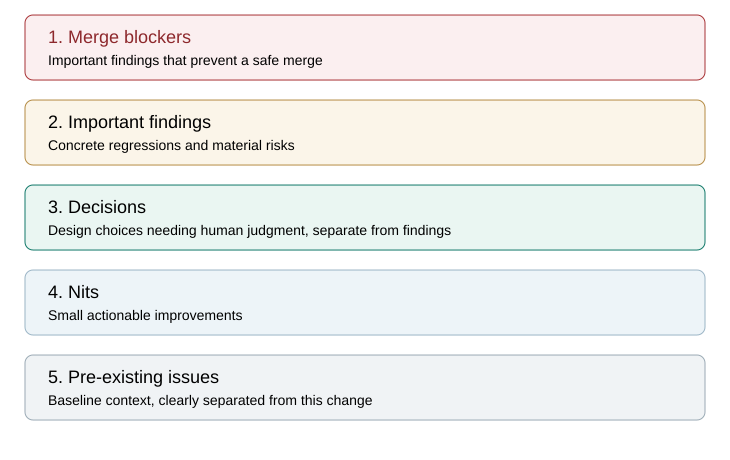
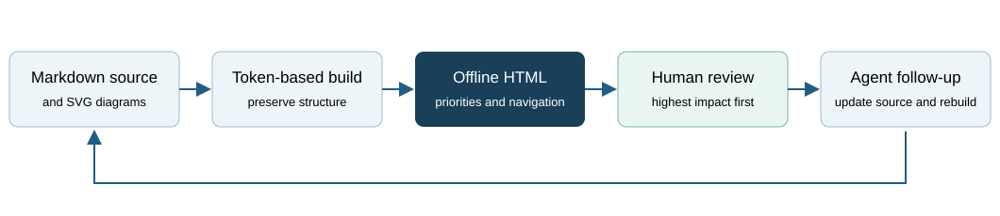

<!-- human-review: {"kind":"guide","status":"reference"} -->
# Reviewing project documents in HTML

Open [the project review desk](index.html). Specs, brainstorms, plans and reviews
have adjacent offline HTML copies. Read the HTML; edit the Markdown source.

## What to read first

Active review pages begin with a prioritized queue, regardless of where those
sections appear in the source:

1. **Merge blockers:** Important findings that prevent a safe merge.
2. **Important findings:** concrete regressions or material risks.
3. **Decisions:** design choices needing human judgment, separate from findings.
4. **Nits:** small actionable improvements.
5. **Pre-existing issues:** useful context, clearly separated from this change.



Use the reading checkboxes to track items you have inspected. Progress is local
to the browser and source version. It does not approve a PR, resolve a finding,
change the source or merge code. Follow section links for complete locations,
impacts, evidence and next steps.

## Authoring and delivery workflow



Install the optional tools once:

```powershell
python -m pip install -e ".[dev,review,docs]"
```

After editing a human-facing Markdown document:

```powershell
python -m mus_computer.documentation build
python -m mus_computer.documentation check
```

`make docs` and `make docs-check` select the project virtual environment too.
Commit source and HTML together; deliver the HTML link in handoffs. The hook is
check-only and refuses stale/missing HTML. CI verifies a fresh checkout.
Generated HTML is marked as generated for GitHub diff presentation, so source
reviews stay focused. Download/open the HTML file to use the rendered view.

For a standalone or ignored training-run summary:

```powershell
python -m mus_computer.documentation render training_runs/example/validation.md
```

This creates `validation.html` without retraining. Existing native HTML reports
can keep their own renderer; do not convert canonical JSON into Markdown first.
The public catalogue excludes ignored runs and private agent directories.

## Explicit document status

Start a live review with this first-line comment:

```text
<!-- human-review: {"kind":"review","status":"active"} -->
```

Kinds: `review`, `spec`, `brainstorm`, `plan`, `guide`, `policy`, `history`.
Statuses: `active`, `draft`, `approved`, `historical`, `reference`, `template`.
Without metadata a document is reference material. Old plans' unresolved
questions or unchecked tasks are never silently promoted to current blockers.
Source checkboxes remain disabled status indicators; reading progress is separate.

Preserve machine-readable front matter required by other tools. If that format
cannot carry this metadata, render it as a reference and add a separate active
review companion. Do not break a tool-owned source schema merely to activate a
review queue.

Active/draft documents opt into priority headings such as:

```markdown
### Blocker: A concrete merge-blocking regression
Location, impact, evidence and next step.

### Important: A material risk
Location, impact, evidence and next step.

### Decision: A design choice
The options, recommendation and practical tradeoff.

### Nit: A small actionable improvement
Location and next step.

### Pre-existing: A relevant earlier issue
Baseline evidence and next step.
```

`Blocker` means an Important merge blocker; it does not add another code-review
repair pass. Empty categories need no placeholder finding. Do not invent issues
or label stylistic preferences Important just to populate the page.

## Hierarchy and diagrams

Use one H1, H2 for major questions and H3/H4 for supporting detail. Every page
has section links and a compact document map extracted from parsed headings.
Fenced code comments are not headings. Tables and code blocks remain readable
without flattening the source's structure.

Prefer small SVG diagrams linked with normal Markdown image syntax. The builder
embeds safe local SVG, so individual HTML pages work offline. Use presentation
attributes for colors/fonts/lines; scripts, HTML-enabled SVG labels, external
resources and unsupported elements are stripped. Export diagrams to plain SVG
when using another authoring tool. No Mermaid CDN or browser-side rendering is
required. Raster images inside the project can also be embedded; external images
remain explicit links and are never fetched automatically.

## Templates and examples

- [Review template](templates/REVIEW.md)
- [Spec template](templates/SPEC.md)
- [Brainstorm template](templates/BRAINSTORM.md)
- [Review this documentation change](REVIEW.md)

Copy a template, replace placeholders and set its status to `draft` or `active`.
Build the HTML before asking a human to inspect it. The parser follows the
[documented Markdown token/renderer interface](https://markdown-it-py.readthedocs.io/en/latest/using.html);
game-only installations do not need that optional package.
