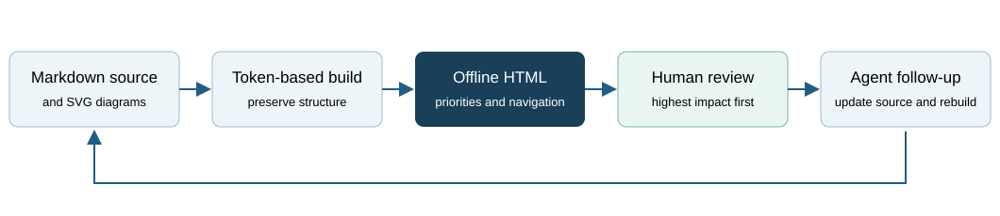

<!-- human-review: {"kind":"review","status":"active"} -->
# Review: HTML-first human documents

This PR is based directly on master. It adds a reusable document renderer and
project review conventions; it does not depend on the unmerged CFR-GLM or
training-framework PRs and does not change bot training or game rules.

## Decisions to inspect

### Decision: Keep Markdown as the authoring source

Agents and existing tools can continue writing source Markdown. Humans receive
adjacent HTML with navigation, diagrams and a prioritized review queue. This
preserves diffs and machine-readable instructions while changing the review
experience. Inspect the source/HTML pairs and the catalogue links.

### Decision: Require fresh HTML before delivery and commit

The generator, Make targets, check-only hook and CI make the format a repeatable
project procedure. Inspect whether the default discovery roots are appropriate.
Private agent folders and ignored training runs are excluded from the catalogue;
single-file rendering remains available for explicitly chosen run summaries.

### Decision: Keep diagrams offline with SVG

Native SVG diagrams and a document map are embedded in each page. This avoids a
CDN or a browser-side diagram dependency. Inspect readability and the documented
SVG subset; complex exports using embedded HTML labels need plain-SVG conversion.

## Evidence to inspect

The test suite covers explicit priority ordering, historical status, headings
inside fenced Python, duplicate anchors, Markdown links, tables, task status,
safe offline SVG, private asset containment and deterministic freshness checks.
Full repository gates and independent review are completed before handoff; their
actual results are recorded in the PR description.

## Boundaries and follow-up

This is a view/generation layer. Reading progress is not an approval or a code
change. Historical plans retain their content and unchecked source statuses.
Legacy training writers remain unchanged; agents use the renderer to deliver
their summaries as HTML. Generated training runs/snapshots remain uncommitted.
